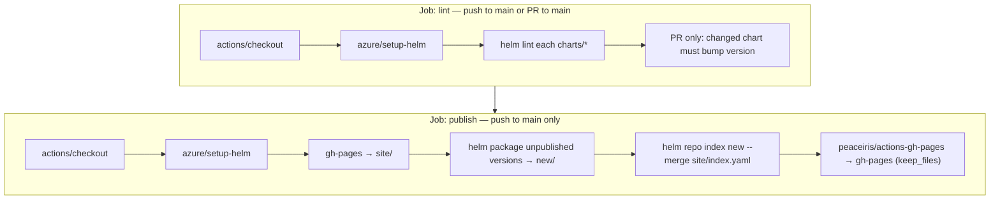

# 02. Publish workflow

Reference for [`.github/workflows/publish-helm.yml`](../.github/workflows/publish-helm.yml): triggers, jobs, permissions, variables, and the shell steps. The workflow lints charts and publishes a classic Helm repository to GitHub Pages.

The workflow creates the `gh-pages` branch. It does not enable GitHub Pages. After the first successful run, set **Settings → Pages → Source** to branch `gh-pages`, folder `/`. The chart repository URL is `https://<owner>.github.io/<repo>/`. For a custom domain, set the repository variable `HELM_PAGES_BASE_URL` with a trailing slash.

---

## Purpose

| Job | When it runs | What it does |
|-----|----------------|---------------|
| **`lint`** | Every **push** to `main` and every **pull request** targeting `main` | Installs Helm, runs **`helm lint`** on each chart under **`charts/*/`**. On PRs, also fails if a chart changed without a **`version`** bump. |
| **`publish`** | Only on **push** to **`main`** (not on PRs) | Packages chart versions **not yet published**, merges them into the existing **`index.yaml`** from **`gh-pages`**, and deploys. Already-published versions are never removed or overwritten. |

Pull requests only validate charts; **nothing is published** until changes land on `main`.

---

## Triggers (`on:`)

```yaml
on:
  push:
    branches: [main]
  pull_request:
    branches: [main]
```

- **`push` to `main`**: runs **both** jobs (`lint` then `publish`).
- **Pull request** into `main`: runs **`lint` only** — the **`publish`** job is skipped (see `if:` below).

---

## Concurrency

```yaml
concurrency:
  group: helm-publish-${{ github.workflow }}-${{ github.ref }}
  cancel-in-progress: ${{ github.event_name == 'pull_request' }}
```

- **`group`**: Identifies a single “lane” per workflow name + git ref (e.g. this branch), so runs on the same ref never overlap.
- **`cancel-in-progress`**: On **PRs**, a new push cancels the older run. On **`main`**, runs are **queued** instead — a publish is never cancelled halfway through deploying to `gh-pages`.

---

## Permissions

```yaml
permissions:
  contents: read
```

Default for the workflow: **read** repo contents (enough for checkout and lint).

The **`publish`** job **overrides** this:

```yaml
permissions:
  contents: write
```

**Why:** Deploying to **`gh-pages`** means **pushing a commit** to the repository. The token needs **`contents: write`**. The **`lint`** job keeps the default read-only permission.

---

## Job: `lint`

### Step: Checkout (`actions/checkout@v4`)

- **What it does:** Clones the repository into the runner. The **`lint`** job uses **`fetch-depth: 0`** (full history) so the version check can compare against the base branch; **`publish`** uses the default shallow clone.
- **Docs:** [actions/checkout](https://github.com/actions/checkout)

### Step: Install Helm (`azure/setup-helm@v4`)

- **What it does:** Downloads and installs the **Helm CLI** at the pinned **`version`** (`v3.16.3`).
- **`with.version`:** Exact Helm version for reproducible builds.
- **Docs:** [Azure/setup-helm](https://github.com/Azure/setup-helm)

### Step: Lint all charts (`run:`)

Shell script (bash):

- **`set -euo pipefail`** — exit on error, undefined variables, pipeline failures.
- **`shopt -s nullglob`** — if `charts/*/Chart.yaml` matches nothing, the glob expands to empty instead of a literal string.
- **`charts=(charts/*/Chart.yaml)`** — builds a list of every chart path.
- If empty → **exit 1** (fail the workflow).
- For each path → **`dirname`** → **`scripts/helm-dep-build.sh`** (downloads **`dependencies:`** from `Chart.yaml` into the chart's **`charts/`** folder; no-op without dependencies) → **`helm lint`** on that chart directory. The publish job and the OCI workflow run the same script before **`helm package`**, which otherwise fails for charts with dependencies.
- **`::group::` / `::endgroup::`** — **GitHub Actions log folding** so each chart’s lint output is collapsible in the UI.

### Step: Require version bump for changed charts (PRs only)

A published chart version must never change content — clients cache packages by name + version, and the publish job skips versions that already exist on `gh-pages`. So on pull requests:

- The PR merge commit is compared with its first parent (the base branch tip).
- For each **`charts/<name>/`** with **any** changed file, **`version`** in **`Chart.yaml`** must be **higher** than on the base branch (a different but lower number fails). **`yq`** reads the version; **`sort -V`** compares it. Pre-release suffixes such as `-rc.1` are not ordered with full SemVer rules.
- New charts (no **`Chart.yaml`** on the base branch) pass.
- One chart per pull request. The title must start with **`[<folder>] `** (for `charts/example`, `[example] …`), the same shape as [prometheus-community/helm-charts](https://github.com/prometheus-community/helm-charts).
- Failures show as annotations on the PR.
- A changelog file is **not** required. Publishing uses the version, not `CHANGELOG.md`.

**`starters/`** changes do not require a bump (they are not published). Docs-only pull requests skip the title rule.

---

## Job: `publish`

### `needs:` and `if:`

```yaml
needs: lint
if: github.event_name == 'push' && github.ref == 'refs/heads/main'
```

- **`needs: lint`**: **`publish`** only starts after **`lint`** succeeds.
- **`if:`**: Run **only** on **`push`** events on branch **`main`**.  
  - `github.event_name` is `pull_request` on PRs → **publish skipped**.  
  - `github.ref` for pushes to main is `refs/heads/main`.

### Context variables used later

| Expression | Meaning |
|------------|--------|
| **`github.repository_owner`** | User or org that owns the repo (used in the default Pages URL). |
| **`github.event.repository.name`** | Repository name (not full name). |
| **`vars.HELM_PAGES_BASE_URL`** | Optional **repository variable** (Settings → Secrets and variables → Actions → Variables). If set, used as **`--url`** for `helm repo index`; otherwise the default **GitHub Pages project URL** is used. |

### Step: Fetch currently published repo from `gh-pages`

If the **`gh-pages`** branch exists, its files (**`index.yaml`** + every published **`.tgz`**) are extracted into **`site/`** with **`git archive`** (no **`.git`** metadata ends up in the published directory). On the very first run there is no branch yet and **`site/`** starts empty.

### Step: Package new chart versions and merge `index.yaml`

**Environment:**

```yaml
env:
  DEFAULT_PAGES_URL: https://${{ github.repository_owner }}.github.io/${{ github.event.repository.name }}/
  HELM_PAGES_BASE_URL: ${{ vars.HELM_PAGES_BASE_URL }}
```

- **`DEFAULT_PAGES_URL`** is built from **GitHub’s context** (no secret required).
- **`HELM_PAGES_BASE_URL`** comes from **repository variables** (`vars.*`). If unset, it is empty.
- In the shell: **`INDEX_URL="${HELM_PAGES_BASE_URL:-$DEFAULT_PAGES_URL}"`** — use the variable if set, else the default.

**Commands:**

1. Loop over **`charts/*/Chart.yaml`**. If **`site/<name>-<version>.tgz`** already exists, that version is published → **skip**. Otherwise **`helm package`** into a temporary **`new/`** directory.
2. If nothing new was packaged, the step sets **`changed=false`** and the deploy step is skipped.
3. **`helm repo index new --url "${INDEX_URL}" --merge site/index.yaml`** — indexes only the new packages and merges in all existing entries (their **`created`** timestamps and digests stay unchanged).
4. Moves the new **`.tgz`** files and the merged **`index.yaml`** into **`site/`**.

**Consequence:** to release changes to a chart you **must** bump its **`version`** — the PR check enforces this. To unpublish a version, delete its **`.tgz`** and its entry in **`index.yaml`** on the **`gh-pages`** branch by hand.

### Step: Deploy to `gh-pages` (`peaceiris/actions-gh-pages@v4`)

| Input | Role |
|--------|------|
| **`github_token`** | **`${{ secrets.GITHUB_TOKEN }}`** — a **per-job token** GitHub creates automatically. **Not** a secret you paste; it is scoped to this repo and allowed to push when **`permissions.contents: write`** is set. |
| **`publish_dir`** | **`./site`** — directory containing **`index.yaml`** and **`*.tgz`**. |
| **`publish_branch`** | **`gh-pages`** — branch that **GitHub Pages** can use as the source branch. |
| **`keep_files`** | **`true`** — never delete files already on **`gh-pages`** (the action's default **`false`** would remove anything not in **`site/`**, e.g. an **`artifacthub-repo.yml`** you added by hand). |
| **`force_orphan`** | **`false`** — keep normal commit history on **`gh-pages`** (not a forced orphan history each time). |

**Docs:** [peaceiris/actions-gh-pages](https://github.com/peaceiris/actions-gh-pages)

---

## Flow summary



**`publish`** runs only after **`lint`** succeeds (`needs: lint`) and only when the event is a **push** to **`main`** (`if:`). After a successful run, **Settings → Pages** should use branch **`gh-pages`** (folder **`/`). Your Helm repo base URL is **`INDEX_URL`** (default GitHub Pages URL or **`HELM_PAGES_BASE_URL`**).

---

## Many charts in `charts/*/` (monorepo)

On **push to `main`**, this workflow packages **only** charts whose current **`version`** is not on **`gh-pages`** yet; **`index.yaml`** keeps listing every chart and every previously published version. A change in **one** `Chart.yaml` is enough; you do **not** need one commit per chart. For **Docker Hub OCI** and **only pushing the chart that released**, see [05-publish-helm-oci-workflow.md](05-publish-helm-oci-workflow.md#many-charts-in-one-repo-monorepo) (per-chart git tags **`name-version`**).

---

## Related docs

- [Hosting guide — Path B](01-hosting-helm-repo.md#path-b--github-actions-automation)
- [docs/05-publish-helm-oci-workflow.md](05-publish-helm-oci-workflow.md) — OCI **`helm push`** in CI, monorepo tags
- [Helm: Chart Releaser Action how-to](https://helm.sh/docs/howto/chart_releaser_action/) (alternative tooling)
